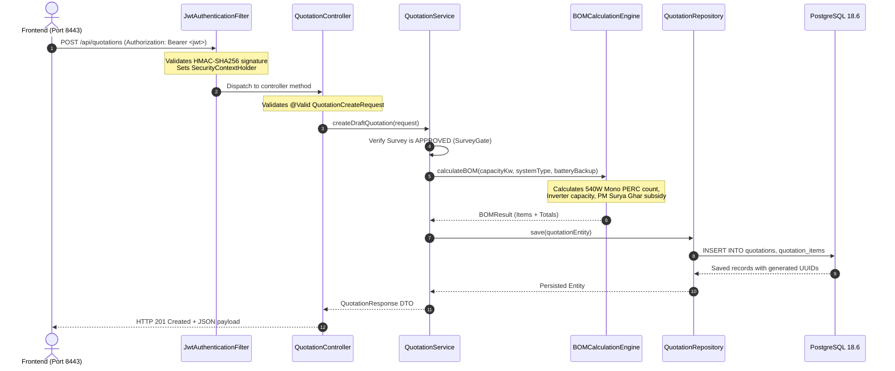

# SunFlow 360 — Backend Architecture Guide

> **System**: SunFlow 360 — AI-Powered Solar Installation & Operations Management System  
> **Backend Framework**: Spring Boot 3.3.5 (Java 21 / 25)  
> **Database**: PostgreSQL 18.6 with Flyway Schema Migrations (V1 to V11)  
> **Security**: Stateless JWT (`jjwt 0.12.5`) with BCrypt Password Hashing  
> **Build Tool**: Apache Maven 3.9.9  
> **Active Server Port**: `8081` (`http://localhost:8081`)

---

## 1. High-Level Architectural Overview

SunFlow 360 is built as a **clean, modular 3-tier enterprise architecture** implementing Domain-Driven Design (DDD) principles:

```text
┌─────────────────────────────────────────────────────────────────────────┐
│                           PRESENTATION LAYER                            │
│   React 19 + TypeScript + Vite + Tailwind CSS (Port 8443)               │
└────────────────────────────────────┬────────────────────────────────────┘
                                     │ HTTP / REST (JSON)
                                     ▼
┌─────────────────────────────────────────────────────────────────────────┐
│                     SPRING SECURITY & FILTER CHAIN                      │
│   • CORS Configuration (Allowed Origins: http://localhost:8443)        │
│   • JwtAuthenticationFilter (Stateless Bearer Token Extraction)         │
│   • SecurityFilterChain (Role-Based Route Authorization)                │
└────────────────────────────────────┬────────────────────────────────────┘
                                     │ Validated Principal (User)
                                     ▼
┌─────────────────────────────────────────────────────────────────────────┐
│                          CONTROLLER LAYER                               │
│   @RestController Endpoints (Lead, Survey, Quotation, Order, etc.)      │
│   • Jakarta Bean Validation (@Valid, @NotNull, @DecimalMin)             │
│   • DTO Deserialization & Response Formatting                           │
└────────────────────────────────────┬────────────────────────────────────┘
                                     │ Validated DTO
                                     ▼
┌─────────────────────────────────────────────────────────────────────────┐
│                           SERVICE LAYER                                 │
│   @Service Business Logic & Domain Orchestration                        │
│   • Survey Feasibility & Approval Gate                                  │
│   • BOM Calculation Engine (PM Surya Ghar Subsidy, Panelling, Inverters) │
│   • Serial Number Barcode Allocation Invariants                         │
│   • Warranty Auto-Generation & Ticket Escalation                        │
└────────────────────────────────────┬────────────────────────────────────┘
                                     │ Domain Entities / Transactions
                                     ▼
┌─────────────────────────────────────────────────────────────────────────┐
│                         PERSISTENCE LAYER                               │
│   Spring Data JPA Repositories + Hibernate 6.5 ORM                      │
│   • LeadRepository, SurveyRepository, QuotationRepository, etc.         │
│   • Declarative Transactions (@Transactional)                           │
└────────────────────────────────────┬────────────────────────────────────┘
                                     │ SQL Queries / JDBC
                                     ▼
┌─────────────────────────────────────────────────────────────────────────┐
│                          DATABASE LAYER                                 │
│   PostgreSQL 18.6 (`sunflow_dev` Database)                              │
│   • Version-Controlled Migrations via Flyway (V1 through V11)           │
│   • Foreign Keys, Check Constraints, JSONB Document Storage             │
└─────────────────────────────────────────────────────────────────────────┘
```

---

## 2. Request Lifecycle & Information Flow

When a client performs an operation (for example, creating a quotation or approving a survey), the request traverses these exact stages:



---

## 3. Package & Module Inventory

The backend code is organized into feature-sliced domain packages under `com.visionx.sunflow`:

| Package | Key Classes | Core Responsibility |
|---|---|---|
| `common` | `SecurityConfig`, `JwtUtils`, `JwtAuthenticationFilter`, `GlobalExceptionHandler`, `ApiErrorResponse` | Cross-cutting infrastructure: token verification, password hashing, CORS, centralized exception translation into RFC-compliant JSON. |
| `user` | `User`, `Role`, `UserRepository`, `UserService`, `UserController` | Identity & Access Management: 8 role types (`ADMIN`, `SALES_REP`, `SURVEYOR`, `ENGINEER`, `INVENTORY_MGR`, `INSTALLER`, `CUSTOMER`, `SUPPORT`). |
| `customer` | `Customer`, `CustomerRepository`, `CustomerService`, `CustomerController` | Solar buyer master record: addresses, billing details, portal linking. |
| `lead` | `Lead`, `LeadRepository`, `LeadService`, `LeadController`, Enums: `LeadStatus`, `PropertyType`, `SystemType` | Lead intake, qualification scoring, pipeline transition, surveyor assignment. |
| `survey` | `Survey`, `SurveyRepository`, `SurveyService`, `SurveyController`, Enums: `SurveyStatus`, `RoofType` | Pre-installation technical site assessments, shadow analysis, structural check, approval gate. |
| `quotation` | `Quotation`, `QuotationItem`, `BOMCalculationEngine`, `QuotationService`, `QuotationController` | Automated Bill of Materials generation, pricing calculations, PM Surya Ghar subsidy formula, discount adjudication. |
| `order` | `SalesOrder`, `Payment`, `OrderRepository`, `OrderService`, `OrderController` | Contract execution: milestones (Deposit, Delivery, Commissioning), payment reconciliation, installation workflow. |
| `inventory` | `Product`, `InventoryUnit`, `StockMovement`, `Supplier`, `PurchaseOrder`, `DispatchOrder` | Warehouse inventory, hardware serial tracking (barcodes), dispatch dispatching to sites. |
| `warranty` | `Warranty`, `ServiceTicket`, `WarrantyRepository`, `ServiceTicketRepository`, `WarrantyService` | Post-commissioning 5-year workmanship warranties, serial component coverage, SLA-tiered service tickets. |
| `analytics` | `AnalyticsController`, `AnalyticsService` | Real-time KPI aggregation: pipeline conversion rates, monthly revenue, operational metrics. |
| `assistant` | `AssistantController`, `ConversationResponse`, `TurnRequest` | AI Operations Assistant: contextual prompt routing, live state summarization. |

---

## 4. Cross-Cutting Concerns & Security

### Stateless JWT Authentication
- The application never stores session state in memory (`SessionCreationPolicy.STATELESS`).
- Every protected API request carries `Authorization: Bearer <token>`.
- `JwtUtils` signs and verifies tokens using `io.jsonwebtoken:jjwt-api:0.12.5` with a secret key configured via `jwt.secret`.

### Centralized Exception Handling
- `GlobalExceptionHandler` (`@RestControllerAdvice`) catches all runtime anomalies:
  - `ResourceNotFoundException` $\rightarrow$ `404 Not Found`
  - `MethodArgumentNotValidException` $\rightarrow$ `400 Bad Request` with field error mappings
  - `IllegalStateException` / `IllegalArgumentException` $\rightarrow$ `422 Unprocessable Entity` or `400 Bad Request`
  - `BadCredentialsException` $\rightarrow$ `401 Unauthorized`

---

## 5. Technology Decision Rationale (For Judges)

1. **Why Spring Boot 3.3.5 & Java 21?**
   - High throughput, robust dependency injection, Virtual Threads ready, strong type safety, and battle-tested enterprise maturity.
2. **Why PostgreSQL 18.6?**
   - Native ACID compliance for financial/order transactions, robust foreign key enforcement, and JSONB capabilities for survey assessment data.
3. **Why Flyway Migrations?**
   - Eliminates database schema drift between development, staging, and production environments. Every schema change is auditable in git.
4. **Why Domain-Driven Packaging?**
   - High cohesion and loose coupling. Each module (`lead`, `quotation`, `inventory`) can evolve independently or be extracted into a microservice in future scale phases.

