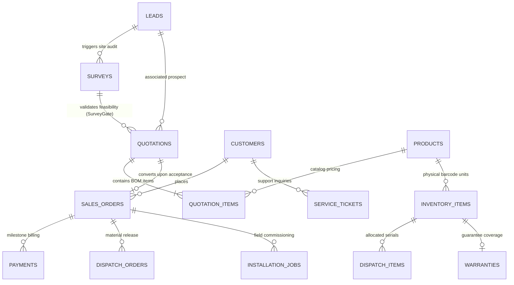

# SunFlow 360 — Database Design & Schema Architecture

> **Database Engine**: PostgreSQL 18.6 (Local port `5432`, database `sunflow_dev`)  
> **Schema Migration Tool**: Flyway 10.10.0 (V1 through V11 migrations)  
> **ORM Framework**: Hibernate 6.5.3 (Spring Data JPA)  
> **Testing Engine**: In-Memory H2 in PostgreSQL compatibility mode (`MODE=PostgreSQL`)

---

## 1. Entity-Relationship (ER) Topology

---

## 2. Table Schemas & Data Dictionary

### A. `leads` (Customer Inquiries & CRM Intake)
- **Primary Key**: `id UUID`
- **Fields**:
  - `full_name VARCHAR(200) NOT NULL`: Prospect full legal name.
  - `phone VARCHAR(20) NOT NULL`: Indexed for deduplication (`idx_leads_phone`).
  - `email VARCHAR(255)`: Communication handle.
  - `property_type VARCHAR(30) DEFAULT 'RESIDENTIAL'`: Determines subsidy eligibility (`RESIDENTIAL`, `COMMERCIAL`, `INDUSTRIAL`).
  - `requested_capacity_kw NUMERIC(8,2)`: Stated power demand.
  - `system_type VARCHAR(20)`: `ON_GRID`, `OFF_GRID`, `HYBRID`.
  - `monthly_bill NUMERIC(10,2)`: Average electricity spend used for solar ROI estimation.
  - `status VARCHAR(20) NOT NULL DEFAULT 'NEW'`: Pipeline lifecycle (`NEW`, `CONTACTED`, `QUALIFIED`, `SURVEY_SCHEDULED`, `DISQUALIFIED`).

### B. `surveys` (Technical Site Feasibility & Survey Gate)
- **Primary Key**: `id UUID`
- **Foreign Key**: `lead_id UUID NOT NULL REFERENCES leads(id) ON DELETE CASCADE`
- **Fields**:
  - `surveyor_name VARCHAR(100) NOT NULL`: Assigned field engineer.
  - `scheduled_at TIMESTAMP WITH TIME ZONE NOT NULL`: Inspection appointment.
  - `status VARCHAR(25) NOT NULL DEFAULT 'SCHEDULED'`: `SCHEDULED`, `COMPLETED`, `APPROVED`, `REJECTED`.
  - `roof_type VARCHAR(30)`: `RCC_FLAT`, `METAL_SHEET`, `TILED_ROOF`.
  - `usable_roof_area_sqft NUMERIC(10,2) CHECK (> 0)`: Verified shadow-free rooftop space.
  - `sanctioned_load_kw NUMERIC(8,2)`: Grid connection limit set by DISCOM (utility).
  - `recommended_capacity_kw NUMERIC(8,2)`: Engineering recommendation based on load and area.
  - `feasibility VARCHAR(30)`: `FEASIBLE`, `FEASIBLE_WITH_CONDITIONS`, `NOT_FEASIBLE`.

### C. `products` (Solar Hardware Catalog)
- **Primary Key**: `id VARCHAR(36)`
- **Fields**:
  - `sku VARCHAR(60) NOT NULL UNIQUE`: Standardized catalog code (e.g. `MOD-540W-MONO`, `INV-3KW-GRID`, `STR-GI-ELEVATED`, `BOS-DC-CABLE-4MM`).
  - `category VARCHAR(50) NOT NULL`: `MODULE`, `INVERTER`, `STRUCTURE`, `BOS`, `BATTERY`.
  - `wattage INT`: Power rating for panels and inverters.
  - `unit_price NUMERIC(12,2) NOT NULL`: Baseline catalog pricing in Indian Rupees (₹).
  - `hsn_code VARCHAR(20)`: Harmonized System of Nomenclature for tax classification.

### D. `quotations` & `quotation_items` (BOM & Pricing Engine)
- **Primary Key**: `id VARCHAR(36)`
- **Unique**: `quote_number VARCHAR(50) NOT NULL UNIQUE` (e.g. `QT-2026-0042`)
- **Foreign Keys**: `lead_id`, `survey_id`, `customer_id`
- **Financial Columns**:
  - `capacity_kw NUMERIC(6,2) NOT NULL`: Sized system capacity.
  - `base_amount NUMERIC(12,2) NOT NULL`: Sum of all quotation item costs.
  - `gst_rate NUMERIC(5,2) DEFAULT 13.80`: Statutory composite solar GST in India (70% goods @ 12% + 30% services @ 18%).
  - `gst_amount NUMERIC(12,2) NOT NULL`: Base amount $\times 13.8\%$.
  - `gross_amount NUMERIC(12,2) NOT NULL`: Base amount $+$ GST.
  - `subsidy_amount NUMERIC(12,2) NOT NULL`: Central PM Surya Ghar subsidy credit (up to ₹78,000 for $\ge 3$ kW residential).
  - `netPayable NUMERIC(12,2) NOT NULL`: Gross amount $-$ Subsidy credit.
  - `status VARCHAR(50) NOT NULL DEFAULT 'DRAFT'`: `DRAFT`, `PENDING_APPROVAL`, `APPROVED`, `SENT`, `ACCEPTED`, `REJECTED`.

### E. `sales_orders` & `payments` (Contract Execution)
- **Primary Key**: `id VARCHAR(36)`
- **Fields**:
  - `total_amount NUMERIC(12,2) NOT NULL`: Total contract value.
  - `advance_required NUMERIC(12,2) NOT NULL`: Mandatory 20% advance required before warehouse material dispatch.
  - `advance_paid NUMERIC(12,2) NOT NULL`: Current sum of accepted advance payments.
  - `outstanding_amount NUMERIC(12,2) NOT NULL`: Total amount $-$ Advance paid.
  - `status VARCHAR(50)`: `PENDING_ADVANCE`, `CONFIRMED`, `DISPATCHED`, `INSTALLED`, `COMPLETED`.

### F. `inventory_items` & `dispatch_orders` (Hardware Barcode Serialization)
- **Primary Key**: `id VARCHAR(36)`
- **Unique**: `serial_number VARCHAR(100) NOT NULL UNIQUE` (e.g. `SN-MOD-540-001`, `SN-INV-3K-001`).
- **Fields**:
  - `status VARCHAR(50)`: `AVAILABLE`, `RESERVED`, `DISPATCHED`, `INSTALLED`, `DEFECTIVE`.
  - **Warehouse Invariant**: No dispatch order can transition to `DISPATCHED` without scanned serial numbers matching active, available inventory units.

### G. `warranties` & `service_tickets` (Lifecycle Governance)
- **`warranties`**:
  - Links physical `serial_number` to `customer_id` and `order_id`.
  - Stores `term_months` (e.g. 60 months / 5 years for inverters & workmanship; 300 months / 25 years for tier-1 modules).
  - Status: `ACTIVE`, `EXPIRED`, `VOID`.
- **`service_tickets`**:
  - `warranty_covered BOOLEAN`: Evaluated automatically against serial number warranty expiration date.
  - `chargeable_amount NUMERIC(12,2)`: If warranty is active, ₹0.00; if expired, billable technician rate.

---

## 3. Flyway Migration Version History

| Version | Migration Script | Key Additions / Schema Changes |
|---|---|---|
| **V1** | `V1__create_leads_table.sql` | `leads` table with phone, city, channel, status, and indices. |
| **V2** | `V2__create_surveys_table.sql` | `surveys` table with roof area check constraints and lead FK. |
| **V3** | `V3__create_users_customers_sites_tables.sql` | `users`, `customers`, and `sites` tables for multi-tenant portal access. |
| **V4** | `V4__seed_hackathon_demo_data.sql` | Preloads realistic demo leads, customers, and site addresses. |
| **V5** | `V5__create_products_and_quotations_tables.sql` | Catalog products, quotations, and quotation BOM line items. |
| **V6** | `V6__create_orders_inventory_dispatches_tables.sql` | Sales orders, milestone payments, warehouse serial inventory, dispatch orders. |
| **V7** | `V7__create_warranties_installations_service_tables.sql` | Serial warranties, installation jobs, service tickets with SLA tracking. |
| **V8** | `V8__add_demo_salespersons.sql` | Seeds demo sales reps with BCrypt passwords. |
| **V9** | `V9__add_survey_photos_notes.sql` | Photo attachments and field notes for mobile surveyor app. |
| **V10** | `V10__widen_quotations_site_id.sql` | Widens `site_id` column to support flexible external system references. |
| **V11** | `V11__add_quotations_customer_id_and_sync_leads.sql` | Links `customer_id` directly to quotations and establishes foreign key integrity. |

---

## 4. Query Performance & Indexing Strategy

1. **Composite & Foreign Key Indices**:
   - `idx_surveys_lead_id` on `surveys(lead_id)`: Enables instant sub-millisecond retrieval of all surveys for a lead.
   - `idx_quotations_lead` on `quotations(lead_id)` and `idx_quotations_survey` on `quotations(survey_id)`.
2. **Status Filter Indices**:
   - `idx_leads_status` on `leads(status)`: Speeds up Kanban dashboard queries (`WHERE status = 'NEW'`).
   - `idx_surveys_status` on `surveys(status)`: Optimizes surveyor task list filtering.
3. **Unique Hardware Constraints**:
   - Unique constraints on `serial_number` across `inventory_items` and `warranties` eliminate hardware counterfeiting, duplicate dispatches, or fraudulent warranty claims.

