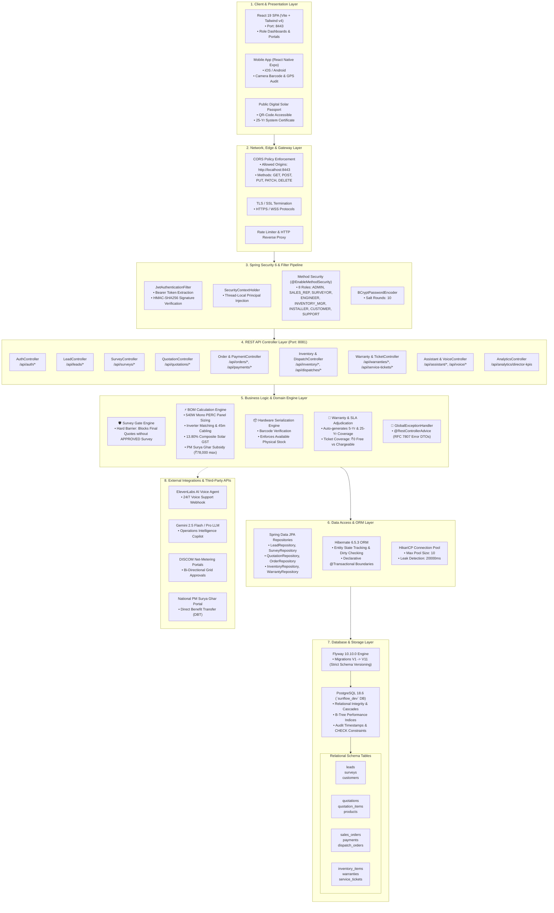
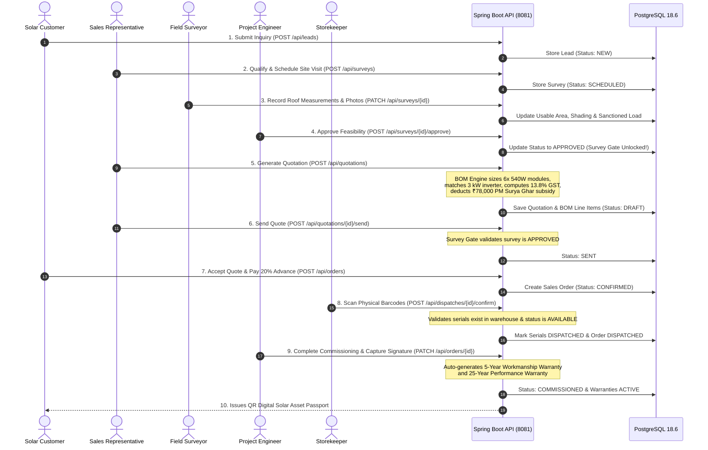

# SunFlow 360 — End-to-End System Design & Architecture Blueprint

This document details the complete end-to-end system design of **SunFlow 360**, covering the presentation tier, network edge, security filter pipeline, micro-domain service architecture, business rule engines, persistence tier, and external integrations.

---

## 1. High-Level System Architecture Diagram



---

## 2. Layer-by-Layer Architectural Breakdown

### A. Presentation & Client Layer (Port 8443)
* **Single-Page Application (SPA)**: Built using **React 19**, **TypeScript**, and **Vite**, styled with **Tailwind CSS v4**.
* **Navigation & Routing**: Managed via `react-router` with role-based route guards (`canAccess`) protecting views according to the authenticated user's segment.
* **State Management**: Reactive in-memory UI store synchronized with backend REST APIs, supporting responsive offline fallbacks.
* **Mobile Client**: Companion **React Native Expo** app (`sunpower-mobile`) providing on-site camera barcode scanning, GPS geolocation tagging, and technician installation checklists.

### B. Security & Gateway Pipeline
```text
HTTP Request (Client)
   │
   ▼
[CORS Filter] ──> Origin: http://localhost:8443, Credentials: true
   │
   ▼
[JwtAuthenticationFilter]
   ├── Extracts Bearer Token from HTTP "Authorization" header
   ├── Validates HMAC-SHA256 signature using secret key
   ├── Decodes claims: Subject (Email), Roles (Authorities), Expiration
   └── Sets SecurityContextHolder.getContext().setAuthentication(...)
   │
   ▼
[SecurityFilterChain Authorization Rules]
   ├── Public Whitelist: /api/auth/**, /api/health, /api/leads, /actuator/**
   └── Authenticated: All Quotation, Order, Dispatch, and Financial Endpoints
```

### C. Domain Controller & Service Engines (Port 8081)
The backend employs a feature-sliced modular architecture where domain entities are decoupled from external transfer contracts using **DTO records**:

1. **The Survey Gate Engine (`QuotationService.java`)**:
   - Inspects the linked survey record prior to quote finalization.
   - Throws `IllegalStateException` unless `survey.getStatus() == SurveyStatus.APPROVED`.
2. **The Solar BOM Calculation Engine (`BOMCalculationEngine.java`)**:
   - Calculates module count: $\lceil (\text{Capacity in Watts}) / 540\text{ W} \rceil$.
   - Sizes matching on-grid string inverter, structure tonnage, and UV-resistant DC cabling.
   - Computes statutory **13.80% composite Indian solar GST**.
   - Calculates **PM Surya Ghar Muft Bijli Yojana Central Subsidy**:
     - $< 1\text{ kW}$: ₹0.00
     - $1\text{ to }<2\text{ kW}$: ₹30,000.00
     - $2\text{ to }<3\text{ kW}$: ₹60,000.00
     - $\ge 3\text{ kW}$: ₹78,000.00 (Max statutory cap)
3. **Hardware Serialization Engine (`InventoryService.java`)**:
   - Mandates unique physical barcode scanning for modules and inverters during warehouse dispatch.
   - Atomically transitions status: `AVAILABLE` $\rightarrow$ `RESERVED` $\rightarrow$ `DISPATCHED` $\rightarrow$ `INSTALLED`.
4. **Warranty & SLA Adjudication (`WarrantyService.java`)**:
   - Plant commissioning auto-creates a **5-year workmanship warranty** and **25-year panel performance warranty**.
   - Service ticket intake auto-checks serial expiration: Active warranty = **₹0.00 Covered Repair**; Expired warranty = Chargeable estimate requiring customer sign-off.

### D. Data Persistence & Flyway Migrations
* **Engine**: PostgreSQL 18.6 (`sunflow_dev` database on port 5432).
* **Connection Pooling**: HikariCP with 10 maximum connections and 20,000ms leak detection.
* **Schema Governance**: Managed via **Flyway 10.10.0** with strict linear migrations (`V1__...` through `V11__...`). Zero manual database schema alterations are permitted.

---

## 3. End-to-End Solar Lifecycle Dataflow


